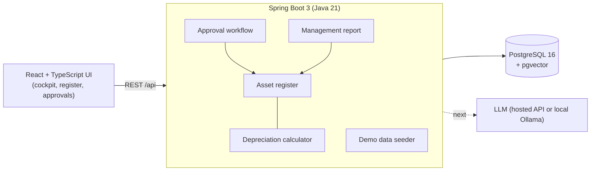

# Asset Intelligence Platform

A fixed-asset and capital expenditure (capex) platform for a fictional New Zealand manufacturer, built as a portfolio project. It covers the full asset lifecycle, from an investment request through approval to the asset register and the management cockpit. AI features (a RAG self-service desk, an approval agent, and invoice extraction) are being added on top.

> **All data is mock data.** *Kowhai Components Ltd* is a fictional company with four plants and 48 sites around New Zealand. The design is inspired by an enterprise asset platform I led as a tech lead, but it contains no code, data, names or branding from any real client.


## Modules

| Module | What it does | Status |
|---|---|---|
| **Asset register** | Every asset with its class, site, supplier, straight-line depreciation, impairment, net book value and last physical verification date. Filter by site, class and status. | ✅ Done |
| **Lifecycle approval** | Investment requests are routed by amount: up to NZ$50k needs the plant manager, up to NZ$500k adds the finance controller, above that adds the CFO. Approvals happen in order, requesters cannot approve their own requests, and a request cannot exceed the site's remaining annual capex budget. Approved requests are capitalised into the asset register. | ✅ Done |
| **Management report** | Cockpit with original value, net book value, accumulated depreciation and impairment, a breakdown per plant and asset class, and a map of every site. | ✅ Done |
| **Self-service desk (RAG)** | Ask questions about capex policy and asset records, with answers that cite their sources. Spring AI + pgvector. | 🚧 Next |
| **Approval agent** | Drafts investment requests and checks policy before submission, using the platform's own APIs as tools. A person always approves. | 🗺️ Planned |
| **Invoice** | Reads supplier invoice PDFs with an LLM and matches them to approved requests. | 🗺️ Planned |

## Architecture



- **Domain rules live in the entities** (`InvestmentRequest` enforces the state machine), so no controller can skip a step.
- **Depreciation is a pure function** (`DepreciationCalculator`), which makes it easy to unit test.
- **Flyway** owns the schema; Hibernate only validates it.
- **Demo data is generated through the real services**, so seeded requests obey the same approval and budget rules as new ones.

## Run it

### With Docker (simplest)

```bash
docker compose up --build
```

Then open http://localhost:8080. The database is seeded with the fictional company on first start.

### For development

Requirements: Java 21, Maven, Node 22, and a PostgreSQL database (the `db` service from `docker compose up db` works).

```bash
# Backend on :8080
cd backend
mvn spring-boot:run

# Frontend on :5173, proxying /api to the backend
cd frontend
npm install
npm run dev
```

### Tests

```bash
cd backend
mvn verify
```

Unit tests cover depreciation, the approval policy and the mock data generator. Integration tests run the full approval workflow and the seeded cockpit through the REST API against an in-memory database.

## API overview

| Method | Path | Purpose |
|---|---|---|
| GET | `/api/dashboard/overview?asOf=YYYY-MM-DD` | Cockpit totals, per-plant breakdown and site map data |
| GET | `/api/assets?site=&category=&status=&page=&size=` | Search the asset register |
| GET | `/api/assets/{tag}` | One asset with values as of today |
| GET | `/api/sites` | All sites |
| GET | `/api/requests?status=` | Investment requests |
| POST | `/api/requests` | Create a draft request |
| POST | `/api/requests/{ref}/submit` | Submit for approval (checks budget) |
| POST | `/api/requests/{ref}/approve` · `/reject` | Decide the next approval step |
| POST | `/api/requests/{ref}/capitalise` | Turn an approved request into an asset |

## Roadmap

- [x] Asset register, depreciation and verification dates
- [x] Investment request workflow with delegation of authority and budget checks
- [x] Management cockpit with site map
- [x] Docker Compose and GitHub Actions CI
- [ ] Sign-in with demo roles (Spring Security)
- [ ] RAG self-service desk with citations, plus an evaluation set (recall@k, faithfulness)
- [ ] Approval agent with tool calling and human approval
- [ ] Invoice extraction and matching
- [ ] Live demo deployment

## About

Built by [Jordan Wang](https://github.com/XiJordanWang), a backend engineer (7 years of Java/Spring, former tech lead) studying for an MSc in Computer Science at the University of Waikato. [Online CV](https://xijordanwang.github.io) · [LinkedIn](https://www.linkedin.com/in/xi-jordan-wang)

## Licence

MIT
