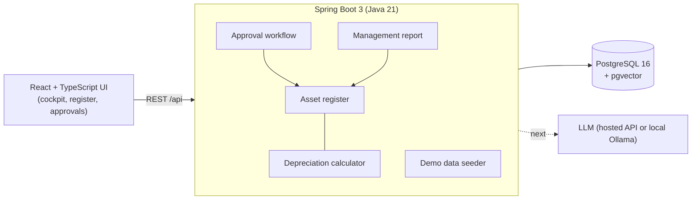

# Asset Intelligence Platform

A fixed-asset and capital expenditure (capex) platform for a fictional New Zealand manufacturer, built as a portfolio project. It covers the full asset lifecycle, from an investment request through approval to the asset register and the management cockpit. AI features (a RAG self-service desk, an approval agent, and invoice extraction) are being added on top.

> **All data is mock data.** *Kowhai Components Ltd* is a fictional company with four plants and 48 sites around New Zealand. The design is inspired by an enterprise asset platform I led as a tech lead, but it contains no code, data, names or branding from any real client.


## Modules

| Module | What it does | Status |
|---|---|---|
| **Asset register** | Every asset with its class, site, supplier, straight-line depreciation, impairment, net book value and last physical verification date. Filter by site, class and status. | ✅ Done |
| **Lifecycle approval** | Investment requests are routed by amount: up to NZ$50k needs the plant manager, up to NZ$500k adds the finance controller, above that adds the CFO. Approvals happen in order, requesters cannot approve their own requests, and a request cannot exceed the site's remaining annual capex budget. Approved requests are capitalised into the asset register. | ✅ Done |
| **Transfers & disposals** | One generic change workflow for existing assets, with a handler per form type. Transfers within a plant need the plant manager; between plants they add the receiving plant manager and finance. Disposals are routed by net book value (up to NZ$10k plant manager, up to NZ$250k adds finance, above that adds the CFO), and lost assets always need finance. An asset is **locked** while a form is open, so it can only have one open change. Every approval step records who acted, what they did and when. | ✅ Done |
| **Master-data changes** | Rename an asset or change its custodian or supplier through the same approval workflow (plant manager, then finance). The form keeps the old and new values side by side, so reviewers see exactly what changes. | ✅ Done |
| **Stocktake** | Finance plans a physical count for a plant and asset class with a sample percentage. Starting it sends each site's coordinator a count list drawn by a repeatable random sample. Coordinators mark each asset found, damaged or missing and submit. Completing the stocktake writes the results back: found assets get a new verification date, damaged ones go to maintenance, and missing ones become draft disposals for finance. | ✅ Done |
| **Excel export** | Download the filtered asset register, or all change forms with their approval trail, as `.xlsx` (Apache POI, streamed). | ✅ Done |
| **Management report** | Cockpit with original value, net book value, accumulated depreciation and impairment, a breakdown per plant and asset class, additions and retirements over the last 12 months, assets by usage status, and a map of every site. | ✅ Done |
| **Plant view** | Drill into one plant on a schematic site plan. Each production area is shaded by its share of net book value; click one to see its biggest assets. Also shows assets per area and value per capex programme, as at the end of any month. | ✅ Done |
| **Sign-in, users and roles** | Twelve fictional colleagues with six roles (requester, plant manager, finance controller, CFO, site coordinator, admin). Visitors first choose an account to sign in as; every page and API call needs a signed-in user, and each approval step only accepts the person it belongs to. Plant managers and coordinators are limited to their own plant. Admins manage roles on a Users & roles page. | ✅ Done |
| **Role-based workspace** | Each role gets its own menu and a *My work* home page: approvals waiting on you (for your plant and approval level), your own drafts and open forms, the sites you still have to count, and finance follow-ups such as requests to capitalise. The server enforces the same split, so a coordinator can't read the management report through the API either. | ✅ Done |
| **Self-service desk (RAG)** | Ask questions about capex policy and asset records, with answers that cite their sources. Spring AI + pgvector. | 🚧 Next |
| **Approval agent** | Drafts investment requests and checks policy before submission, using the platform's own APIs as tools. A person always approves. | 🗺️ Planned |
| **Invoice** | Reads supplier invoice PDFs with an LLM and matches them to approved requests. | 🗺️ Planned |

## Architecture



- **Domain rules live in the entities** (`InvestmentRequest` enforces the state machine), so no controller can skip a step.
- **Depreciation is a pure function** (`DepreciationCalculator`), which makes it easy to unit test.
- **Flyway** owns the schema; Hibernate only validates it.
- **Demo data is generated through the real services**, so seeded requests obey the same approval and budget rules as new ones.
- **Strategy per change type.** `AssetChangeService` runs one state machine for every change and asks a `ChangeHandler` (`TransferHandler`, `DisposalHandler`, `ModificationHandler`) for validation, the approval route and the effect. Spring injects all handlers into a map keyed by type, so a new form type is one new class.
- **Who acts comes from the session, never the request body.** Controllers read the signed-in user (`Actor`) and check it against the step that is waiting (`Actor.requireCanDecide`), so nobody can approve as someone else by editing JSON. Spring Security uses a session cookie plus a CSRF token cookie that the React app sends back as a header.
- **Concurrency.** Assets and change forms use optimistic locking (`@Version`), so two approvers clicking at the same moment cannot both succeed; the loser gets a clear 409.

## Project structure

Each business module is its own package, split into the usual layers:

```
backend/src/main/java/io/github/xijordanwang/assetintel/
├─ asset/        controller · service · repository · entity · dto
├─ approval/     controller · service · repository · entity · dto      (investment requests)
├─ change/       controller · service(+handler) · repository · entity · dto   (transfers, disposals, edits)
├─ stocktake/    controller · service · repository · entity · dto
├─ dashboard/    controller · service · dto                            (cockpit and plant view)
├─ export/       controller                                            (Excel)
├─ site/         controller · repository · entity
├─ security/     config · controller · service · repository · entity  (sign-in, users, roles)
├─ workspace/   controller · service · dto                            ("My work" home per role)
├─ demo/         config · service                                      (fictional company generator)
└─ common/       config · exception · web
```

## Demo users

Every demo user has the password `demo` (it is a public demo with generated data). The sign-in page lists them all; a few to start with:

Each role sees a different menu:

| Role | Menu |
|---|---|
| Requester | My work, Asset register, Investment requests, Asset changes |
| Plant manager | Everything except Users & roles (reports, approvals and stocktakes for their plant) |
| Finance controller | Everything except Users & roles |
| CFO | My work, reports, Asset register, Investment requests, Asset changes |
| Site coordinator | My work, Asset register, Stocktake |
| Admin | Everything, plus Users & roles |

| User | Role | Try |
|---|---|---|
| `aroha.requester` | Requester (Hamilton) | Raise an investment request or transfer an asset |
| `tama.plantmanager` | Plant manager (Hamilton) | Approve the first step of Hamilton requests |
| `grace.finance` | Finance controller | Approve larger amounts, capitalise, plan a stocktake |
| `hemi.cfo` | CFO | Approve requests over NZ$500k |
| `pita.coordinator` | Site coordinator (Hamilton) | Count assets in the Hamilton stocktake |
| `sam.admin` | Admin | Grant and remove roles |

## Run it

### Without Docker (only Java 21 needed)

```bash
./run-local.sh
```

The first run takes a few minutes: Maven downloads its own copy of Node to build the UI, then starts the app with an embedded H2 database (stored in `backend/data/`). Open http://localhost:8080 when the log says `Seeded demo data`.

### With Docker (production-like, PostgreSQL)

```bash
docker compose up --build
```

Then open http://localhost:8080. The database is seeded with the fictional company on first start.

### For development

Requirements: Java 21 and Node 22. No database to install: the backend uses an embedded H2 database in `backend/data/` unless `DB_URL` points at PostgreSQL.

```bash
# Backend on :8080
cd backend
./mvnw spring-boot:run

# Frontend on :5173, proxying /api to the backend
cd frontend
npm install
npm run dev
```

### Put it online (Render, free plan)

The repo has a `render.yaml` blueprint, so hosting is a few clicks:

1. Push the repo to GitHub.
2. Sign in at [render.com](https://render.com) with GitHub, choose **New → Blueprint**, and pick this repository.
3. Render builds the Dockerfile and gives you a URL like `https://asset-intelligence.onrender.com`.

The free plan sleeps after 15 minutes without visitors, so the first visit after a break takes about a minute. The demo database is rebuilt with fresh data on every start, so visitors can try everything without breaking it for good. To keep data between restarts, create a free PostgreSQL database (for example on Neon) and set `DB_URL`, `DB_USER` and `DB_PASSWORD` on the Render service.

### Tests

```bash
cd backend
mvn verify
```

Unit tests cover depreciation, the approval policy and the mock data generator. Integration tests run the full approval workflow, check what each role can open, and the seeded cockpit through the REST API against an in-memory database.

## API overview

| Method | Path | Purpose |
|---|---|---|
| POST | `/api/auth/login` · `/api/auth/logout` | Sign in (JSON body) and out; a session cookie is set |
| GET | `/api/auth/me` · `/api/auth/personas` | The signed-in user, and the demo people to choose from |
| GET | `/api/my-work` | The signed-in person's to-do list, grouped by role |
| GET · PUT | `/api/users` · `/api/users/{username}/roles` | List users and change roles (admin only) |
| GET | `/api/dashboard/overview?asOf=YYYY-MM-DD` | Cockpit totals, per-plant breakdown and site map data |
| GET | `/api/dashboard/plants/{plant}?upTo=YYYY-MM` | One plant at a month end: totals, areas with top assets, programmes |
| GET | `/api/assets?site=&category=&status=&page=&size=` | Search the asset register |
| GET | `/api/assets/{tag}` | One asset with values as of today |
| GET | `/api/sites` | All sites |
| GET | `/api/requests?status=` | Investment requests |
| POST | `/api/requests` | Create a draft request |
| POST | `/api/requests/{ref}/submit` | Submit for approval (checks budget) |
| POST | `/api/requests/{ref}/approve` · `/reject` | Decide the next approval step |
| POST | `/api/requests/{ref}/capitalise` | Turn an approved request into an asset |
| GET | `/api/changes?status=` | Transfers, disposals and master-data changes |
| POST | `/api/changes` | Create a draft transfer, disposal or master-data change |
| POST | `/api/changes/{ref}/submit` | Lock the asset, capture its net book value and work out the route |
| POST | `/api/changes/{ref}/approve` · `/reject` · `/cancel` | Decide the next step, or cancel as the requester |
| GET | `/api/stocktakes` · `/api/stocktakes/{ref}` | Stocktakes with progress per site |
| POST | `/api/stocktakes` | Plan a stocktake (scope, sample %, due date) |
| POST | `/api/stocktakes/{ref}/start` | Draw the sample and create one count list per site |
| GET | `/api/stocktakes/{ref}/sites/{site}` | One site's count list |
| POST | `/api/stocktakes/{ref}/sites/{site}/count` · `/submit` | Record a result, or submit the site's count as its coordinator |
| POST | `/api/stocktakes/{ref}/complete` · `/cancel` | Write results back to the register, or cancel |
| GET | `/api/export/assets.xlsx?site=&category=&status=` | Asset register as Excel |
| GET | `/api/export/changes.xlsx` | Change forms with approval trail as Excel |

## Roadmap

- [x] Asset register, depreciation and verification dates
- [x] Investment request workflow with delegation of authority and budget checks
- [x] Transfers and disposals with value-based routing, asset locking and an audit trail
- [x] Management cockpit with site map and 12-month trend
- [x] Plant view with a clickable site plan and month-end history
- [x] Docker Compose and GitHub Actions CI
- [x] Sign-in with demo users and roles (Spring Security), plant-scoped approvals
- [x] Master-data change forms with old and new values
- [x] Physical verification (stocktake) campaigns with sampling and site coordinators
- [x] Excel export
- [ ] Excel import
- [ ] Reminder emails for overdue approvals (outbox pattern)
- [ ] RAG self-service desk with citations, plus an evaluation set (recall@k, faithfulness)
- [ ] Approval agent with tool calling and human approval
- [ ] Invoice extraction and matching
- [ ] Live demo deployment

## About

Built by [Jordan Wang](https://github.com/XiJordanWang), a backend engineer (7 years of Java/Spring, former tech lead) studying for an MSc in Computer Science at the University of Waikato. [Online CV](https://xijordanwang.github.io) · [LinkedIn](https://www.linkedin.com/in/xi-jordan-wang)

## Licence

MIT
